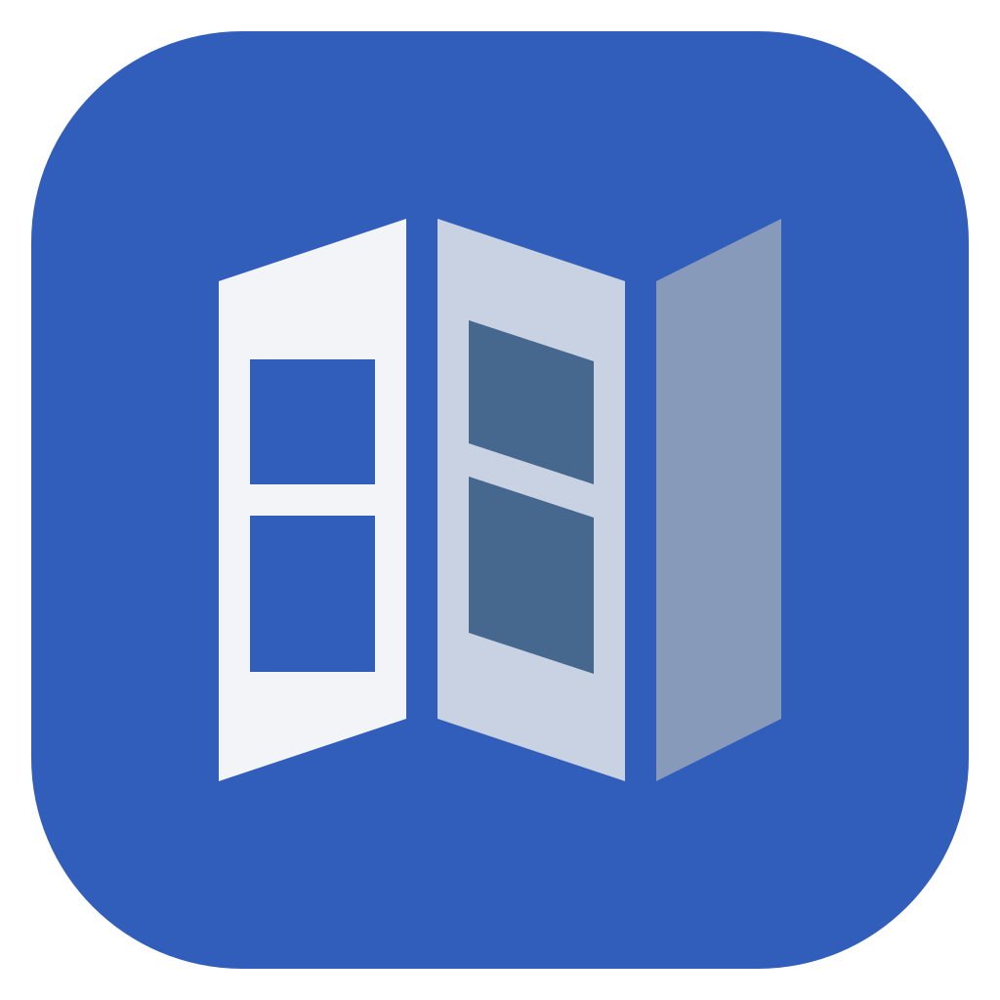

# DiskUnfold

Understand what takes up your space.

DiskUnfold is an open-source desktop project for understanding where your disk space goes. The goal is to explore storage visually, see what changed between scans, and review cleanup plans before making changes to your files.

Version 0.1 is in development. The current foundation includes a Tauri and React shell, a command-line entry point, and shared Rust contracts. Storage analysis, cleanup, MCP tools, and release packaging are planned.

## Run the foundation

Use the Rust toolchain from `rust-toolchain.toml` and Node.js from `.node-version`. Install the native prerequisites for your platform: MSVC and WebView2 on Windows, Xcode Command Line Tools on macOS, and the WebKitGTK 4.1 and GTK development packages on Linux. See [Tauri prerequisites](https://v2.tauri.app/start/prerequisites/).

```sh
npm --prefix gui-web ci --ignore-scripts
npm --prefix gui-web run build
cargo run --locked -p du-launcher
cargo run --locked -p du-launcher -- --help
cargo run --locked -p du-launcher -- --version
```

The same executable opens the GUI without arguments and prints help or version information when requested. Use `--no-default-features` on the Cargo command for a development build that exercises only the CLI.

## Verify changes

```sh
cargo fmt --all -- --check
cargo clippy --locked --workspace --all-targets --all-features -- -D warnings
cargo test --locked --workspace --all-features
cargo run --locked -p du-arch-check --
npm --prefix gui-web run check
npm --prefix gui-web run test
```

After changing the common contracts, regenerate the TypeScript declarations and review the diff:

```sh
cargo run --locked -p du-core-contracts --features typescript --example export_types -- gui-web/src/ipc/generated
```

On Linux with Xvfb, Openbox, xdotool, and a D-Bus session, the startup test checks that the same binary prints CLI output, opens a window, and exits on a window close request:

```sh
cargo build --locked -p du-launcher
bash release-packaging/launcher/smoke-linux.sh target/debug/diskunfold
```

The quality workflow publishes test, structure, duplication, and coverage reports. The 80% line coverage target is tracked separately for Rust and the GUI. See [quality tools](release-packaging/quality/README.md) for local reporting commands and the target matrix.

## Architecture and feature handoff

The foundation follows the DiskUnfold 0.1 published AIDA architecture HLD revision 191 and DLD revision 1234. Cargo crates correspond to the design targets. Entry points and composition are separate from domain logic. OS and storage adapters implement contracts at their boundaries. The DLD 3.4 placement decisions apply to the storage adapters and launcher.

| AIDA design items | Foundation location |
| --- | --- |
| AFR1.gui-web.ADD1, AFR2.app-host.ADD1, AFR4.cli.ADD1 | GUI, Tauri lifecycle, CLI mode and launcher |
| AFR5.core-contracts.ADD1, AFR27.core-contracts.ADD1, AFR31.core-contracts.ADD1, AFR32.core-contracts.ADD1 | Value types, port definitions and common envelopes |
| AFR26.app-db.ADD1 | SQLite connection configuration and temporary database tests |
| AFR34.release-packaging.ADD1 | Cargo dependency and Rust source checks, GUI import rules |
| AFR35.platform-os.ADD1 | Development-only fake filesystem, time, random bytes and faults |
| AFR22.release-packaging.ADD1, AFR33.release-packaging.ADD1, AFR35.release-packaging.ADD1 | Locked toolchains, CI and quality reports |

Each module should have one reason to change. Use a published feature DLD to map a feature's ADD or DD items to its owner, contract and tests. Run the foundation checks before adding feature behavior. The AIDA code profile for the repository has not been verified.

The Linux x64 container was used for the initial build and GUI startup check. Windows Application Control blocked native build artifacts on the development host. Other operating system and CPU combinations require their own CI or device verification.

DiskUnfold is [MIT licensed](LICENSE).
