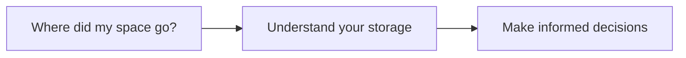

# ByteTrail

Understand where your disk space goes.

A full drive often starts with a simple question: "What is taking up all this
space?" Finding the answer can mean opening folder after folder, trying to make
sense of unfamiliar files, and wondering what you still need.

ByteTrail is a project for making disk space easier to understand. Its role is
to help people see how their storage is being used and make more informed
decisions about their files.

## Why ByteTrail?

We want to make storage problems easier to explore, even if you are not a
technical expert. The purpose is to turn confusing disk usage into information
you can understand and use, whether you are running out of room or simply want
to know what is on your drive.

## Project status

ByteTrail is at the concept stage. The name and the role described above are
established; specific features, supported platforms, and implementation details
are still being explored. This repository does not yet provide a usable
application.

## License

See [LICENSE](LICENSE) for the repository's current license terms.
