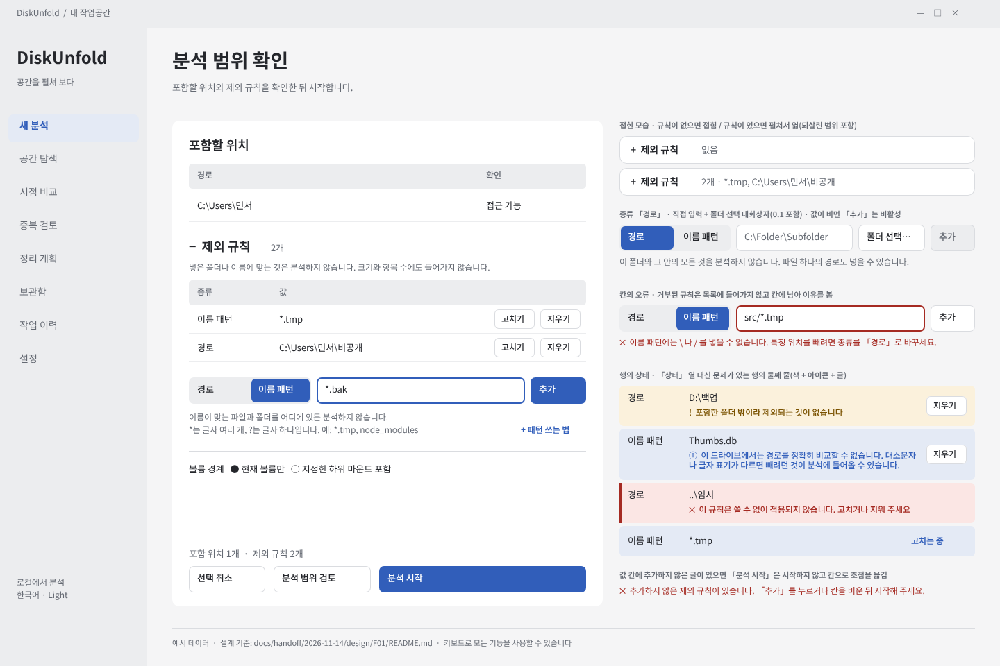
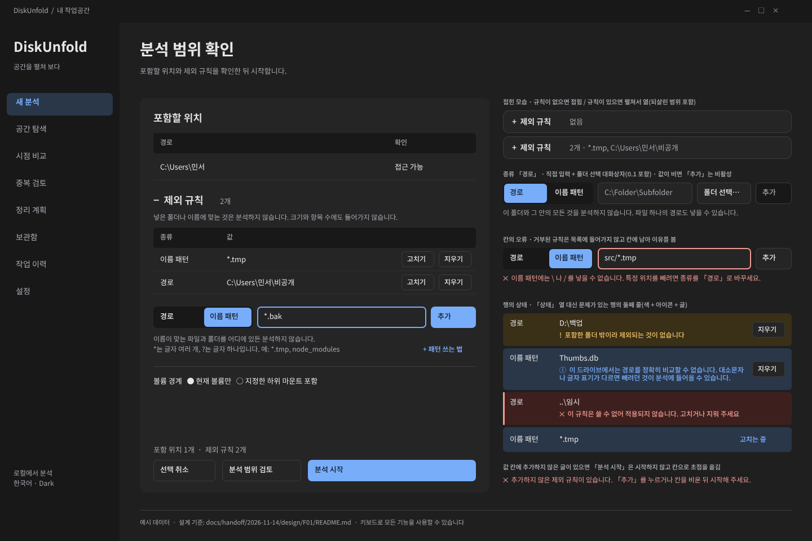

# F01 범위 편집 화면의 제외 규칙 입력 (디자인팀 설계, 2026-11-15)

총괄 요청에 따른 설계다. 구현은 F02(F01 임시 담당)가 표준화팀의 결정 뒤에 한다. 화면 문구의 기준은 [TERMS.md](../TERMS.md)다.

## 근거와 한계

- 읽은 것(AIDA, 발행본): F01 HLD 137판의 기능 요구 표(FR4.HD1), 2.3.2 「분석 범위 구성과 검토」 전체(실패·취소 흐름 표, 정규화 단계 표, 화면 표시·입력·상태 표), 2.2.3의 IF-02 줄. F01 DLD 136판의 FR4.HD1.app-host.DD1·gui-web.DD1, gui-web 절 전체, 2.3.2 「범위 정규화·검토와 최근 범위」.
- 읽지 않은 것: SRS 47판 본문(HLD의 FR4 인용으로 대신함), HLD 2.3.1·2.3.3·2.3.4, DLD의 나머지 절.
- 구현에서 확인한 것(origin/0.0.1): 계약은 `ScopeExclusion` 두 종류(path, name_pattern)다. 화면에는 제외 규칙을 넣는 곳이 없고 검토 결과와 최근 범위에서 읽기 전용으로만 보인다. 범위 검토는 「분석 범위 검토」 단추를 눌러야 돈다. 폴더를 고르는 운영 체제 대화상자는 제품에 없다(경로 입력과 폴더 끌어 놓기뿐이다).
- F02가 알린 것: 지금 Windows에서는 제외 규칙이 거절된다. 이 문서는 규칙이 발행 설계대로 동작한다고 보고 썼다.
- 그림: Penpot 12번 페이지의 보드 「scope · 제외 규칙 입력 (F01 · 디자인팀 설계)」(Light·Dark)가 이 문서의 화면이다. 아래 두 장은 그 보드를 내보낸 것이다. 왼쪽 카드는 규칙 둘이 있는 펼친 모습(값 칸에 초점), 오른쪽은 접힌 모습 둘, 종류가 「경로」일 때의 입력 줄, 칸의 오류, 행의 상태 넷, 추가하지 않은 글이 있을 때의 안내다. 승인안 「scope · 수집 조건」 보드는 고치지 않았다. 그 보드의 제외 규칙 표(종류·값·상태)는 이 보드로 대신한다. 보드를 그린 코드는 penpot-spec/spec12-add-f01-exclusions.mjs다.





## 1. 원칙

1. 제외 규칙은 덜 쓰는 기능이다. 규칙이 없으면 한 줄로 접혀 있고, 「분석 시작」은 창 높이 720 CSS px에서도 스크롤 없이 보인다.
2. 목록에 있는 규칙은 모두 적용되는 규칙이다. 쓸 수 없는 규칙은 목록에 들어가지 못하고 입력 칸에 남아 그 자리에서 이유를 본다.
3. 규칙을 더하거나 지우면 바로 검토한다. 사용자가 「분석 범위 검토」를 따로 누르지 않아도 규칙이 받아들여졌는지, 효과가 있는지 2초 안에 안다.
4. 사용자가 적용됐다고 믿는 규칙이 빠진 채로 분석이 시작되면 안 된다.

## 2. 자리와 배치

포함 경로 영역 바로 아래, 볼륨 경계 위에 「제외 규칙」 펼침을 둔다. 승인안의 순서(포함할 위치 → 제외 규칙 → 볼륨 경계)와 같다.

접힌 모습:

```text
+ 제외 규칙   없음
+ 제외 규칙   2개 · *.tmp, C:\Users\민서\비공개
```

- 규칙이 없으면 접혀 있다. 규칙이 하나라도 있으면(최근 범위에서 되살린 경우 포함) 펼쳐서 연다. 적용될 규칙은 시작 전에 보여야 한다.
- 접힌 줄의 요약은 세 개까지 쓰고 넘으면 「외 N개」다(결과 요약의 줄과 같은 규칙, F02 README 28번).

펼친 모습(규칙 둘, 종류가 「이름 패턴」일 때):

```text
- 제외 규칙   2개
  넣은 폴더나 이름에 맞는 것은 분석하지 않습니다. 크기와 항목 수에도 들어가지 않습니다.

  종류         값
  이름 패턴    *.tmp                               [고치기] [지우기]
  경로         C:\Users\민서\비공개                [고치기] [지우기]

  ( 경로 | 이름 패턴 )   [ *.bak________________________ ]   [추가]
  이름이 맞는 파일과 폴더를 어디에 있든 분석하지 않습니다.
  *는 글자 여러 개, ?는 글자 하나입니다. 예: *.tmp, node_modules      + 패턴 쓰는 법
```

종류가 「경로」일 때의 입력 줄:

```text
  ( 경로 | 이름 패턴 )   [ C:\Folder\Subfolder__________ ] [폴더 선택…]   [추가]
  이 폴더와 그 안의 모든 것을 분석하지 않습니다. 파일 하나의 경로도 넣을 수 있습니다.
```

- 승인안의 「상태」 열은 두지 않는다. 문제가 없는 행마다 「유효」가 반복되면 정보가 없다(탐색 표의 「사용 가능 여부」 열을 뺀 것과 같은 이유). 상태는 문제가 있는 행의 둘째 줄로 보인다(4번).
- 목록은 다섯 줄까지 보이고 넘으면 목록 안에서만 스크롤한다. 입력 줄과 「분석 시작」은 목록 밖에 있다(DLD의 검증 기준 "긴 목록에서 목록만 이동"과 같다). 줄 높이는 40 CSS px다.
- 순서는 넣은 순서다. 검토 결과가 정렬해 돌려줘도 화면의 순서는 바꾸지 않는다. 방금 넣은 규칙이 다른 자리로 가면 찾을 수 없다.
- 긴 경로는 경로 표시 규칙으로 줄을 바꾼다. 줄이지 않는다.
- 폭이 480 CSS px보다 좁으면 행은 두 줄이 된다. 첫 줄에 종류(작은 글자)와 「지우기」, 둘째 줄에 값. 입력 줄은 종류 선택, 값 칸, 단추 순서로 세로로 쌓인다.
- 포함 경로가 하나도 없으면 입력 줄을 비활성으로 두고 「포함할 폴더를 먼저 고르면 제외 규칙을 넣을 수 있습니다」를 쓴다. 이미 있는 규칙 행은 그대로 보인다.

## 3. 넣기, 고치기, 지우기

종류: 라디오 묶음 둘(「경로」, 「이름 패턴」). 처음 값은 「경로」다. 종류를 바꾸면 값 칸의 이름표·보기 글·도움말이 바뀌고, 넣던 글은 지우지 않는다.

경로를 넣는 길:

| 길 | 0.1 | 비고 |
| --- | --- | --- |
| 직접 입력·붙여넣기 | 필수 | 키보드만으로 되는 길이다 |
| 「폴더 선택…」(운영 체제의 폴더 선택 대화상자) | 필수로 요청 | 제품에 아직 없다. 포함 경로에도 같은 단추가 필요하다. 전체 경로를 외워서 치게 하는 것은 대부분의 사용자에게 쓸 수 없는 화면이다. 대화상자는 첫 포함 경로에서 연다. 새 IPC와 platform-os 포트가 필요하므로 일정은 총괄이 정한다. 들어오기 전까지는 구현 공백으로 적는다 |
| 값 칸에 폴더 끌어 놓기 | 되면 넣음 | 지금의 끌어 놓기 부품을 쓴다. 놓은 자리가 제외 칸인지 구별할 수 있어야 한다(F02 확인 필요). 구별할 수 없으면 0.1에서는 두지 않는다 |
| 결과에서 「다음 분석에서 제외」(탐색 표와 그래프의 행 메뉴) | 후속 | 무엇을 뺄지는 결과를 본 뒤에 알게 된다. 가장 자연스러운 길이지만 다시 분석 흐름과 함께 설계해야 한다 |

넣기:

1. 값을 넣고 Enter나 「추가」를 누른다. 값이 비어 있으면 「추가」는 비활성이다.
2. 같은 종류와 같은 글자의 규칙이 이미 있으면 보내지 않고 「이미 있는 규칙입니다」를 칸 아래에 쓰고 그 행을 잠깐 강조한다.
3. 화면은 그 규칙을 더한 초안으로 scope.review를 보낸다. 「추가」에 도는 표시와 「확인 중…」이 보인다. 기다리는 동안에도 칸에 글을 칠 수 있고, 「추가」만 응답이 올 때까지 다시 누를 수 없다.
4. 받아들여지면 규칙이 목록 끝에 들어가고 칸이 비고 초점은 칸에 남는다(다음 규칙을 이어서 넣는다). 칸의 글이 보낸 것과 달라져 있으면 칸은 그대로 둔다.
5. 거부되면(scope.exclude_invalid) 목록은 그대로이고 칸 아래에 이유가 보인다(5번). 초안은 직전 유효 초안으로 남으므로 직전 유효 검토 결과와 「분석 시작」의 상태가 바뀌지 않는다(FR4.HD1.gui-web.DD1 그대로).

고치기: 행의 「고치기」를 누르면 그 규칙의 종류와 값이 입력 줄로 올라오고 행에는 「고치는 중」이 보인다. 「추가」가 「바꾸기」로 바뀌고 옆에 「취소」가 생긴다. 「바꾸기」는 그 행을 새 값으로 바꾼 초안을 검토에 보낸다. 받아들여지면 행이 바뀌고, 거부되면 행은 원래 값 그대로이고 칸 아래에 이유가 보인다. Esc나 「취소」는 고치기를 끝내고 칸을 비운다.

지우기: 확인 없이 바로 지우고 검토를 다시 보낸다. 상태 영역으로 한 번 알린다.

「분석 시작」과의 관계:

- 검토를 기다리는 동안 「분석 시작」은 지금처럼 비활성이다.
- 「분석 시작」을 눌렀을 때 값 칸에 추가하지 않은 글이 있으면 시작하지 않는다. 초점을 칸으로 옮기고 「추가하지 않은 제외 규칙이 있습니다. 「추가」를 누르거나 칸을 비운 뒤 시작해 주세요」를 쓴다. 단추의 켜짐 상태는 바꾸지 않는다. 사용자가 넣었다고 믿는 규칙이 빠진 채로 몇 분짜리 분석이 도는 것을 막는다.
- 목록에 쓸 수 없는 규칙 행이 있으면(되살린 초안에서만 생긴다) 유효한 검토 결과를 얻을 수 없으므로 「분석 시작」은 켜지지 않는다. 그 행에 이유와 「고치기」·「지우기」가 있다.

## 4. 행의 상태

상태는 색과 아이콘과 글을 함께 쓴다. 문제 줄은 행의 둘째 줄이고, 행 높이는 그만큼 늘어난다.

| 상태 | 때 | 모양 | 둘째 줄 |
| --- | --- | --- | --- |
| 보통 | 받아들여졌고 알릴 것이 없음 | 표시 없음 | 없음 |
| 효과 없음 | scope.exclusion_ineffective | 경고 색조(--du-warning-surface, --du-warning-text), 경고 아이콘 | 포함한 폴더 밖이라 제외되는 것이 없습니다 |
| 확인 못 함 | 비교 근거가 없어 겹침을 판정하지 못함(키는 표준화팀이 정한다) | 정보 색조(--du-info-surface, --du-info-text), 정보 아이콘 | 이 드라이브에서는 경로를 정확히 비교할 수 없어, 이 규칙이 걸리는지 확인하지 못했습니다 |
| 쓸 수 없음 | 되살린 초안의 규칙이 scope.exclude_invalid로 거부됨 | 오류 색조(--du-danger-surface, --du-danger-text), 오류 아이콘, 행 왼쪽에 3 CSS px 띠 | 이 규칙은 쓸 수 없어 적용되지 않습니다. 고치거나 지워 주세요 |
| 고치는 중 | 「고치기」를 누름 | 선택 색조(--du-selected-surface) | 고치는 중 |

포함 경로 쪽의 알림:

- 포함한 폴더가 제외 규칙에 걸려 통째로 빠지면(scope.excluded) 그 포함 경로 행에 경고로 「이 폴더는 제외 규칙에 걸려 분석하지 않습니다」를 쓴다.
- 남는 포함 경로가 없으면 「분석 시작」 위에 오류로 「분석할 폴더가 남지 않았습니다. 제외 규칙을 지우거나 포함할 폴더를 더 골라 주세요」를 쓰고 시작할 수 없다.

행에 붙일 수 있는 알림은 행에만 쓴다. 지금 계약의 알림은 키만 있고 어느 규칙의 것인지가 없다. 어느 규칙인지 모르는 동안에는 규칙 목록 아래에 한 줄로 쓴다(5번의 대체 문구). 화면이 "방금 넣은 규칙일 것"이라고 추측해서 행에 붙이지 않는다.

## 5. 문구

| 자리 | 한국어 | English |
| --- | --- | --- |
| 펼침 제목 | 제외 규칙 | Exclusions |
| 요약(없음) | 없음 | None |
| 요약(있음) | {n}개 · {규칙 셋까지} 외 {m}개 | {n} · {up to three rules} and {m} more |
| 설명 | 넣은 폴더나 이름에 맞는 것은 분석하지 않습니다. 크기와 항목 수에도 들어가지 않습니다. | Anything that matches won't be analyzed and isn't included in the size or the item count. |
| 열 이름 | 종류 / 값 | Kind / Value |
| 종류 | 경로 / 이름 패턴 | Path / Name pattern |
| 경로 칸 이름표 | 제외할 경로 | Path to exclude |
| 경로 칸 도움말 | 이 폴더와 그 안의 모든 것을 분석하지 않습니다. 파일 하나의 경로도 넣을 수 있습니다. | This folder and everything in it won't be analyzed. You can also enter the path of a single file. |
| 패턴 칸 이름표 | 제외할 이름 패턴 | Name pattern to exclude |
| 패턴 칸 도움말 | 이름이 맞는 파일과 폴더를 어디에 있든 분석하지 않습니다. *는 글자 여러 개, ?는 글자 하나입니다. 예: *.tmp, node_modules | Files and folders whose name matches won't be analyzed, wherever they are. * stands for any number of characters and ? for one. Examples: *.tmp, node_modules |
| 단추 | 폴더 선택… / 추가 / 바꾸기 / 취소 / 고치기 / 지우기 | Choose folder… / Add / Save / Cancel / Edit / Remove |
| 행 단추의 접근 이름 | ‘{규칙}’ 제외 규칙 고치기 / ‘{규칙}’ 제외 규칙 지우기 | Edit exclusion ‘{rule}’ / Remove exclusion ‘{rule}’ |
| 확인 중 | 확인 중… | Checking… |
| 포함 경로 없음 | 포함할 폴더를 먼저 고르면 제외 규칙을 넣을 수 있습니다. | Choose a folder to include first, then add exclusions. |
| 이미 있음 | 이미 있는 규칙입니다. | This rule is already in the list. |
| 쓸 수 없는 이름 패턴 (scope.exclude_invalid) | 이 이름 패턴은 쓸 수 없습니다. 비워 둘 수 없고 \ 나 / 를 넣을 수 없습니다. | This name pattern can't be used. It can't be empty or contain \ or /. |
| 쓸 수 없는 경로 (scope.exclude_invalid) | 이 경로는 쓸 수 없습니다. 드라이브부터 시작하는 전체 경로를 넣어 주세요. 예: C:\Users\민서\비공개 | This path can't be used. Enter a full path starting from the drive, for example C:\Users\Minseo\Private. |
| 쓸 수 없는 규칙, 위치 모름 | 제외 규칙 가운데 쓸 수 없는 것이 있습니다. 규칙을 확인해 주세요. | One of the exclusions can't be used. Check the rules. |
| 효과 없음, 어느 규칙인지 모름 (대체) | 포함한 폴더 밖에 있어 효과가 없는 제외 경로가 있습니다. | An excluded path is outside the included folders and has no effect. |
| 포함한 폴더가 빠짐, 어느 폴더인지 모름 (대체) | 제외 규칙에 따라 선택한 폴더가 분석 범위에서 빠졌습니다. (지금 문구 그대로) | (unchanged) |
| 추가하지 않은 글이 있음 | 추가하지 않은 제외 규칙이 있습니다. 「추가」를 누르거나 칸을 비운 뒤 시작해 주세요. | An exclusion hasn't been added yet. Select Add or clear the field, then start. |
| 알림(추가) | ‘{규칙}’ 제외 규칙을 추가했습니다. 제외 규칙 {n}개. | Added exclusion ‘{rule}’. {n} exclusions. |
| 알림(지움) | ‘{규칙}’ 제외 규칙을 지웠습니다. 제외 규칙 {n}개. | Removed exclusion ‘{rule}’. {n} exclusions. |

macOS와 Linux에서는 경로 오류의 예와 보기 글을 "/로 시작하는 전체 경로", "/Users/minseo/Private"로 쓴다.

「패턴 쓰는 법」(패턴 칸 도움말 끝의 펼침, 기본 접힘):

- 이름 하나에만 맞춥니다. 특정 위치만 빼려면 종류를 「경로」로 바꾸세요.
- 폴더 이름이 맞으면 그 안의 모든 것이 빠집니다.
- 대소문자를 구분하는지는 드라이브를 따릅니다. Windows 드라이브는 보통 구분하지 않습니다.

| 패턴 | 맞는 이름 |
| --- | --- |
| `*.tmp` | 끝이 .tmp인 모든 이름 |
| `node_modules` | 정확히 node_modules |
| `~$*` | ~$로 시작하는 이름 |
| `backup-????` | backup- 뒤에 네 글자가 오는 이름 |

용어: 사용자가 넣은 것은 「제외 규칙」, 그 규칙에 걸려 빠진 것은 「제외된 항목」이다. 검토 결과와 최근 범위와 결과 요약에서 규칙 목록을 보이는 줄의 이름표도 「제외 규칙」으로 맞춘다(지금 「제외 항목」, 키 ui.analysis.exclusions). 영어는 Exclusions 그대로다.

## 6. 검토 결과 표와의 연결

- 검토 결과의 「범위 경로 및 경계」에 있는 제외 줄은 그대로 둔다. 엔진이 받아들인 범위를 확인하는 자리다. 이름표는 「제외 규칙」, 값은 세 개까지와 「외 N개」다.
- 규칙에 대한 알림(효과 없음, 확인 못 함)은 규칙 행에 쓰고 검토 알림 목록에 다시 쓰지 않는다. 같은 말이 두 번 나오지 않게 한다.
- 승인안 오른쪽 「분석 요약」의 「제외 규칙 2개」는 그대로다. 누르면 「제외 규칙」 펼침이 열리고 초점이 그 제목으로 간다.

## 7. 키보드와 화면 낭독기

- 탭 순서: 포함 경로 영역 → 「제외 규칙」 펼침 단추 → 규칙 행의 「고치기」, 「지우기」(행 순서대로) → 종류 선택(라디오 묶음, 화살표로 바꿈) → 값 칸 → 「폴더 선택…」 → 「추가」(고치는 중이면 「바꾸기」, 「취소」) → 「패턴 쓰는 법」 → 볼륨 경계.
- 값 칸에서 Enter는 「추가」다. 한글 입력 조합 중의 Enter는 무시한다(포함 경로 칸과 같다). Esc는 고치는 중일 때만 고치기를 끝낸다. 칸의 글을 지우지 않는다.
- 추가한 뒤 초점은 값 칸에 남는다. 지운 뒤 초점은 같은 자리의 다음 행 「지우기」 → 마지막 행의 「지우기」 → 값 칸 순서로 간다(공통 초점 규칙). 고치기를 끝내면 그 행의 「고치기」로 돌아간다.
- 칸의 오류는 칸에 이어 붙여(설명으로 연결) 초점이 칸에 있는 채로 한 번 읽힌다. 칸에는 잘못됨 상태를 준다. 초점을 다른 곳으로 옮기지 않는다.
- 추가와 지움은 상태 영역으로 한 번 알린다(5번의 알림 문구). 규칙 수를 함께 말한다.
- 행의 문제 줄은 행의 「고치기」, 「지우기」 단추의 설명으로 연결한다. 목록을 훑을 때 어느 규칙에 문제가 있는지 들린다.
- 확대 200%와 폭 320 CSS px에서 가로 스크롤 없이 모든 동작에 닿는다.

## 8. Light와 Dark

새 색은 없다. 위 표의 토큰(--du-warning-*, --du-info-*, --du-danger-*, --du-selected-surface, --du-focus)은 두 테마에 값이 있다. 강제 색상 모드에서는 색조 바탕이 사라지므로 아이콘과 글, 오류 행의 왼쪽 띠(시스템 색)로 구별한다.

## 9. 표준화팀과 F02에 요청하는 것

1. 알림에 대상을 실어 달라. scope.exclusion_ineffective와 "겹침 판정 불확실"에는 규칙 위치, scope.excluded에는 빠진 포함 경로. 지금은 키만 있어 어느 규칙인지 보일 수 없다. 규칙이 열 개인데 "효과 없는 것이 있습니다"만 말하면 사용자는 하나씩 지워 보며 찾아야 한다.
2. scope.exclude_invalid에 세부 사유를 실어 달라(빈 값, 구분자가 든 패턴, 전체 경로가 아님 등). 지금은 종류별로 뭉뚱그린 문구밖에 쓸 수 없다.
3. 모든 포함 경로가 제외에 걸렸을 때 검토가 무엇을 돌려주는지 알려 달라(4번의 "분석할 폴더가 남지 않았습니다"를 언제 보일지).
4. 폴더 선택 대화상자(포함·제외 공통)의 계약.
5. 끌어 놓은 자리가 제외 칸인지 구별할 수 있는지(F02).
6. 발행 DLD의 "거부는 직전 검토 지문을 바꾸지 않으므로 분석 요청 단추 상태도 바뀌지 않는다"는 이 문서에서 "거부된 규칙은 초안에 들어가지 않는다"로 풀었다. 3번의 「분석 시작」 처리(추가하지 않은 글이 있으면 시작하지 않음)는 발행 문서에 없는 화면 규칙이다. 다음 개정에서 적을지 총괄이 정한다.

## 10. 검수 때 받을 캡처

한국어 Light, Dark는 둘째와 넷째만: 접힌 줄(없음), 규칙 둘이 있는 펼친 모습(종류 경로와 이름 패턴 각각의 입력 줄), 「확인 중…」, 칸의 오류(패턴, 경로), 효과 없음 행, 고치는 중, 추가하지 않은 글이 있을 때 「분석 시작」을 누른 모습, 규칙 일곱 개(목록 안 스크롤), 폭 480 미만, 확대 200%.

## 11. 표준화팀의 계약 결정과 그에 따른 화면 (2026-11-15 밤)

표준화팀이 9번의 1~3을 정했다(범위 검토 코드와 응답 타입을 읽고 정한 것). 총괄도 세 가지를 정했다: 폴더 선택 대화상자는 0.1에 넣고 포함 경로와 제외 경로에 함께 쓴다(담당 F02, 순서는 제외 규칙 엔진 연결 다음). 3번의 "추가하지 않은 글이 있으면 시작하지 않음"을 승인했고 F02가 F01 DLD gui-web 개정에 적는다. 이름표 「제외 규칙」을 승인했다.

알림의 대상(응답의 선택 필드 noticeTargets, 보낸 초안 안의 위치로 가리킴):

| 알림 키 | 대상 | 화면 |
| --- | --- | --- |
| scope.exclusion_ineffective | 제외 규칙 | 그 규칙 행에 「효과 없음」(4번) |
| scope.exclusion_unverified | 제외 규칙 | 그 규칙 행에 「확인 못 함」(4번). 4번 표의 "키는 표준화팀이 정한다"가 이 키다 |
| scope.excluded | 포함 경로 | 그 포함 경로 행에 「이 폴더는 제외 규칙에 걸려 분석하지 않습니다」 |
| scope.overlap_unverified | 포함 경로 | 그 포함 경로 행에 정보로 「이 드라이브에서는 경로를 정확히 비교할 수 없어, 다른 포함 폴더와 겹치는지 확인하지 못했습니다」 / "Paths on this drive can't be compared exactly, so it couldn't be confirmed whether this folder overlaps another included folder." |

- 대상이 없거나 그 키의 항목이 없으면 5번의 대체 문구를 목록 아래 한 줄로 쓴다. scope.exclusion_unverified의 대체 문구는 「경로를 정확히 비교할 수 없는 드라이브가 있어, 걸리는지 확인하지 못한 제외 규칙이 있습니다」 / "Paths on a drive can't be compared exactly, so some exclusions couldn't be confirmed."
- 대상이 잘렸으면(truncated) 행 표시에 더해 목록 아래에 「표시한 것 말고도 해당하는 규칙이 더 있습니다」 / "More rules than the ones marked are affected."를 쓴다.
- 기존 겹침 알림 셋(합침, 별칭 병합, 하위 흡수)에 대상을 싣는 것은 0.1에 필요하지 않다. 지금 문구("겹치는 포함 경로 2개를 하나로 합쳤습니다")로 뜻이 통하고 포함 경로는 대개 몇 개뿐이다. 포함 경로 행을 다시 그릴 때 함께 본다.

거부의 세부 원인(오류의 선택 필드 argumentIssues, 위치와 원인 키):

| 원인 키 | 한국어 | English |
| --- | --- | --- |
| scope.exclude.empty | 값을 넣어 주세요. | Enter a value. |
| scope.exclude.separator | 이름 패턴에는 \ 나 / 를 넣을 수 없습니다. 특정 위치를 빼려면 종류를 「경로」로 바꾸세요. | A name pattern can't contain \ or /. To exclude a specific location, change the kind to Path. |
| scope.exclude.not_absolute | 드라이브부터 시작하는 전체 경로를 넣어 주세요. 예: C:\Users\민서\비공개 | Enter a full path starting from the drive, for example C:\Users\Minseo\Private. |
| scope.exclude.encoding | 이 경로는 이 컴퓨터의 경로 형식이 아닙니다. 경로를 다시 넣어 주세요. | This path isn't in this computer's path format. Enter the path again. |
| path.unresolvable (제외 규칙에서 난 경우) | 이 경로는 해석할 수 없습니다. ‘..’ 같은 표기 없이 전체 경로를 넣어 주세요. | This path can't be resolved. Enter a full path without parts such as ‘..’. |
| 원인 키가 없거나 모르는 키 | 5번의 종류별 문구 | |

- 위치가 방금 넣으려던 규칙이면 값 칸 아래에, 목록에 있는 규칙이면 그 행의 둘째 줄에 쓴다. 한 번에 여러 규칙이 거부되면(되살린 초안) 행마다 제 원인을 쓴다.
- macOS와 Linux에서는 not_absolute의 문구를 "/로 시작하는 전체 경로", 예 "/Users/minseo/Private"로 쓴다.

남는 포함 경로가 없을 때: scope.review는 scope.empty로 거부한다(빈 범위의 성공은 없다). 그래서 4번의 "분석할 폴더가 남지 않았습니다"를 「분석 시작」 위에 쓰는 경우는 없어진다. 규칙을 넣다가 이 거부를 받으면 그 규칙은 목록에 들어가지 않고 값 칸 아래에 「이 규칙을 넣으면 분석할 폴더가 남지 않습니다. 규칙을 바꾸거나 포함할 폴더를 더 골라 주세요」 / "With this rule no folder is left to analyze. Change the rule or include another folder."를 쓴다. 같은 키가 포함 경로를 하나도 넣지 않았을 때에도 나오므로, 오류가 제외 규칙의 위치를 싣고 있을 때만 이 문구를 쓰고 그렇지 않으면 지금의 빈 범위 안내를 쓴다(위치를 실을 수 있는지는 F02가 확인한다).

아직 정해지지 않은 것: Windows 쪽의 검증 규칙("\"도 구분자로 거절, 드라이브부터 시작하는 전체 경로)은 구현 전이고 F02가 확정해 알린다. "*"와 "?"의 뜻은 표준화팀이 이번에 코드로 확인하지 않았다. 5번의 도움말은 발행 DLD 2.3.2의 문법을 따른 것이다.

## 12. F02의 확인에 따른 결정 (2026-11-15 밤)

- 제외 칸의 폴더 끌어 놓기는 0.1에 두지 않는다. 끌어 놓기는 창 전체에서 받고 놓은 자리가 화면에 전달되지 않는다. 끌어 놓은 폴더는 지금처럼 포함 경로로 들어간다. 3번 표의 "되면 넣음"은 "0.1 이후"로 읽는다.
- 포함 경로를 바꿨을 때도 검토를 자동으로 보낸다(발행 HLD 표 29 그대로). 규칙은 자동이고 경로는 단추를 눌러야 하면 한 화면에 두 방식이 섞인다. 보내는 때는 경로가 정해진 때다: 경로 칸에서 Enter, 값이 바뀐 채로 칸을 떠남, 드라이브 고르기, 폴더 끌어 놓기, 폴더 선택 대화상자에서 고름, 경로 추가·제거. 글자를 칠 때마다 보내지 않는다. 「분석 범위 검토」 단추는 남긴다. 드라이브를 다시 꽂았을 때처럼 초안은 그대로인데 다시 확인하려는 경우에 쓴다. 이 변경은 제외 규칙 화면 PR이나 폴더 선택 대화상자 PR에 넣는다(F02가 고른다).
- 검토가 2초를 넘는 경우(느린 저장소): 「확인 중…」과 도는 표시를 그대로 두고, 2초가 지나면 그 옆에 「드라이브 응답을 기다리는 중」을 더한다. 기다리는 동안에도 칸에 글을 칠 수 있다.
- "확인 못 함" 두 알림의 문구를 결과까지 말하게 바꾼다(4번과 11번의 문구를 이것으로 바꾼다). 무엇이 달라질 수 있는지 모르면 사용자는 알림을 읽고도 할 일을 알 수 없다.

| 키 | 자리 | 한국어 | English |
| --- | --- | --- | --- |
| scope.exclusion_unverified | 규칙 행(범위 편집) | 이 드라이브에서는 경로를 정확히 비교할 수 없습니다. 대소문자나 글자 표기가 다르면 빼려던 것이 분석에 들어올 수 있습니다. | Paths on this drive can't be compared exactly. If the letter case or the spelling form differs, something you meant to exclude may be analyzed. |
| scope.overlap_unverified | 포함 경로 행(범위 편집) | 이 드라이브에서는 경로를 정확히 비교할 수 없습니다. 포함한 폴더끼리 겹치면 같은 것을 두 번 셀 수 있습니다. | Paths on this drive can't be compared exactly. If included folders overlap, the same items may be counted twice. |
| scope.exclusion_unverified | 결과 요약의 「제외 규칙」 줄 아래 | 경로를 정확히 비교할 수 없는 드라이브였습니다. 빼려던 것이 결과에 들어 있을 수 있습니다. | Paths on this drive couldn't be compared exactly. Something you meant to exclude may be in the result. |
| scope.overlap_unverified | 결과 요약의 「스캔한 경로」 줄 아래 | 경로를 정확히 비교할 수 없는 드라이브였습니다. 겹치는 폴더가 있으면 크기가 두 번 세어졌을 수 있습니다. | Paths on this drive couldn't be compared exactly. If folders overlap, sizes may have been counted twice. |

- 한 알림이 목록의 모든 규칙을 가리키고 규칙이 둘 이상이면 행마다 쓰지 않고 목록 아래에 한 번만 쓴다. macOS에서는 0.1 동안 제외 규칙이 있으면 scope.exclusion_unverified가 늘 붙는다(F02). 모든 행에 같은 줄이 반복되면 읽지 않게 된다. 결과 요약의 두 줄은 정보 색조의 보조 글이고 경고 배지로 쓰지 않는다.
- 거부 위치의 필드 이름은 표준화팀 결정대로 argumentIssues다(위치와 원인 키).
- F02의 구현 순서: Cloud Files 자리 표시자 변경 → 탐색 행 연결 → 제외 규칙 엔진 → 화면 → 폴더 선택 대화상자.
